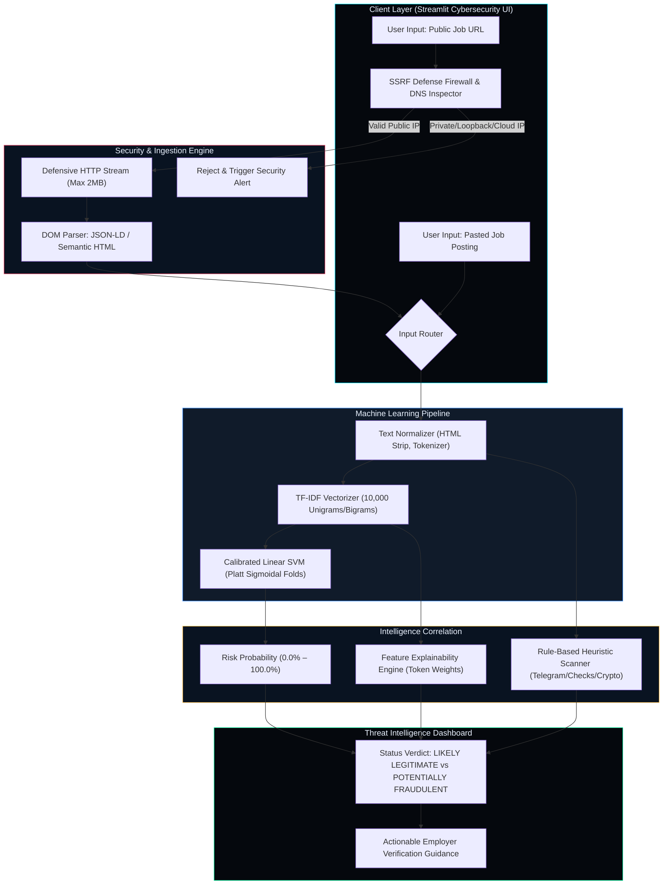

# PHANTOM // JOBINTEL
## AI-Powered Fake Job Advertisement Detection System
*BTech Computer Science and Engineering Capstone Project*

[](#)
[](#)
[](#)
[](#)
[](#)

---

## 1. Project Abstract & Mission

**PHANTOM // JOBINTEL** is a production-grade machine learning and open-source threat intelligence system designed to detect fraudulent recruitment advertisements. With the exponential surge in remote employment, recruitment scams have become a weaponized attack vector for credential harvesting, identity theft, and advance-fee wire fraud.

This application provides job seekers, universities, and cybersecurity analysts with a dual-mode verification radar:
1. **Mode 1: Paste Job Details** — Deep statistical NLP and heuristic red flag analysis of pasted job listings.
2. **Mode 2: Analyze Job URL** — Secure remote webpage fetching and structured JSON-LD / DOM parsing protected by an enterprise-grade Server-Side Request Forgery (SSRF) defense firewall.

---

## 2. System Architecture



---

## 3. Real Dataset Provenance & Characteristics

The system was trained on the real Kaggle **Real or Fake: Fake JobPosting Prediction** dataset (`fake_job_postings.csv`).

| Parameter | Measured Value | Description |
|:---|:---|:---|
| **Total Advertisement Records** | **17,880** | Full real-world recruitment postings |
| **Total Features** | **18 columns** | Multimodal text, metadata, and labels |
| **Legitimate Postings (`0`)** | **17,014 (95.16%)** | Verified authentic job postings |
| **Fraudulent Postings (`1`)** | **866 (4.84%)** | Confirmed recruitment fraud listings |
| **Class Imbalance Ratio** | **~19.65 : 1** | Severe class imbalance requiring custom weighting |
| **Missing Values (Top 3)** | `salary_range` (84.0%), `department` (64.6%), `benefits` (20.3%) | Handled via safe imputation and text bundling |

---

## 4. Empirical Machine Learning Benchmarks

All models were evaluated on an identical **held-out test set of 3,576 advertisements (20% stratified split)**.

| Algorithm | Overall Accuracy | Fraud Precision | Fraud Recall | Fraud F1-Score | Macro F1-Score | PR-AUC |
|:---|:---:|:---:|:---:|:---:|:---:|:---:|
| **Logistic Regression** (Balanced Weights) | 97.43% | 70.98% | **91.91%** | 80.10% | 89.28% | 0.8651 |
| **Multinomial Naive Bayes** ($\alpha=0.1$) | 98.07% | 84.14% | 70.52% | 76.73% | 87.79% | 0.8123 |
| **Linear SVM (Calibrated Champion)** 🏆 | **99.05%** | **97.28%** | **82.66%** | **89.38%** | **94.44%** | **0.9324** |

### Why Linear SVM (Calibrated) Won:
1. **Highest Fraud F1-Score (89.38%):** Delivers the strongest harmonic balance between catching fraudulent jobs and minimizing false alerts.
2. **Exceptional Precision (97.28%):** When PHANTOM flags an advertisement as fraudulent, it is correct in 97.3 out of 100 cases, maintaining high operational credibility for legitimate employers.
3. **True Probability Support via Platt Calibration:** Linear SVM's signed geometric margins are calibrated using `CalibratedClassifierCV(cv=3, method='sigmoid')`, producing valid, well-calibrated posterior probabilities.

---

## 5. Security & SSRF Defensive Architecture

To protect the server during remote URL analysis, `src/security.py` enforces defense-in-depth:
- **Strict Protocol Whitelist:** Only `http` and `https` allowed.
- **Pre-Flight DNS Address Inspection:** Hostnames are resolved to IP addresses *prior* to connection. Any IP falling in private (RFC 1918), loopback (`127.0.0.1`), link-local (`169.254.x.x`), or multicast ranges is instantly rejected.
- **Cloud Metadata Defense:** Blocks queries targeted at AWS/GCP/Azure internal metadata services (`169.254.169.254`).
- **Redirect Re-Validation Loop:** HTTP 301/302 redirects are validated iteratively up to 3 hops.
- **Buffer Exhaustion Defense:** HTTP responses are streamed in 8 KB chunks with a hard cap of 2 MB to eliminate zip/decompression bombs.

---

## 6. Project Structure

```
ml project/
│
├── app.py                     # Streamlit Cybersecurity Intelligence Dashboard
├── train.py                   # Model training and evaluation entrypoint
├── requirements.txt           # Verified Python dependencies
├── README.md                  # Comprehensive technical documentation
├── .gitignore                 # Version control ignore rules
│
├── data/
│   └── fake_job_postings.csv  # 17,880 recruitment dataset
│
├── models/
│   └── best_model_pipeline.joblib  # Serialized calibrated production pipeline
│
├── reports/
│   ├── dataset_summary.json        # Empirical dataset statistics
│   ├── model_metrics.json          # Complete JSON metrics per algorithm
│   ├── model_comparison.csv        # Tabular model benchmark
│   ├── model_comparison.png        # Bar chart comparison
│   ├── eda_class_distribution.png  # Class imbalance chart
│   ├── eda_missing_values.png      # Feature missingness breakdown
│   ├── eda_text_length_distribution.png # Advertisement word density
│   ├── confusion_matrix_linear_svm_calibrated.png
│   ├── confusion_matrix_logistic_regression.png
│   ├── confusion_matrix_multinomial_naive_bayes.png
│   ├── BTech_Mini_Project_Report.md
│   ├── Viva_Voce_Questions_and_Answers.md
│   ├── Project_Presentation_Outline.md
│   └── Project_File_Guide.md
│
├── src/
│   ├── __init__.py
│   ├── config.py              # Centralized paths, themes, hyperparameters
│   ├── data_loader.py         # Schema validation & dataset loading
│   ├── preprocessing.py       # Regex text cleaning & feature bundler
│   ├── train_model.py         # End-to-end model training workflow
│   ├── evaluate.py            # Confusion matrix & metric calculators
│   ├── predict.py             # Inference engine & rule-based indicators
│   ├── explainability.py      # TF-IDF feature weight extraction
│   ├── url_analyzer.py        # JSON-LD & DOM job content parser
│   └── security.py            # SSRF, RFC1918 filter & input sanitizer
│
└── tests/
    ├── test_data_loader.py    # Schema & data integrity tests
    ├── test_preprocessing.py  # Cleaning & formatting tests
    ├── test_prediction.py     # Rule-based heuristics & inference tests
    ├── test_security.py       # SSRF defenses & protocol validation
    ├── test_url_analyzer.py   # DOM parsing & fixture extraction
    └── test_app.py            # End-to-end pipeline integration tests
```

---

## 7. Windows PowerShell Installation & Execution

### Prerequisites
- Windows 10 or 11
- PowerShell 5.1 or PowerShell 7

### Step 1: Create and Activate Virtual Environment
```powershell
# Navigate to project directory
cd "C:\Users\noelj\OneDrive\Pictures\ml project"

# Create virtual environment with Python 3.11
python -m venv .venv

# Activate environment
.\.venv\Scripts\Activate.ps1
```
*(If PowerShell execution policy prevents script activation, run: `Set-ExecutionPolicy -Scope Process -ExecutionPolicy RemoteSigned`)*

### Step 2: Install Required Packages
```powershell
python -m pip install --upgrade pip
python -m pip install -r requirements.txt
```

### Step 3: Run Model Training & Evaluation
```powershell
python train.py
```
*Outputs real metrics, generates charts in `reports/`, and serializes `best_model_pipeline.joblib`.*

### Step 4: Run Automated Test Suite
```powershell
python -m pytest -v
```
*Executes all 26 unit and integration tests across data loading, preprocessing, heuristics, security, and extraction.*

### Step 5: Launch PHANTOM Web Dashboard
```powershell
python -m streamlit run app.py
```
*Opens `http://localhost:8501` in your default browser.*

---

## 8. Responsible Use & Disclaimers

- **AI-Assisted Guidance:** PHANTOM // JOBINTEL is a statistical threat intelligence aid. Predictions reflect linguistic patterns in training corpora and must not replace independent human due diligence.
- **Employer Verification:** Always cross-reference job openings on the official corporate careers website and search national corporate registers (e.g. SEC EDGAR, MCA, Companies House).
- **Zero Financial Transactions:** Legitimate employers will never demand payments for application processing or require candidates to cash advance checks for equipment purchases.

---

## 9. Academic Project Credits

- **Course:** B.Tech Computer Science and Engineering
- **System Name:** PHANTOM // JOBINTEL
- **Frameworks:** Python 3.11, Scikit-Learn, Pandas, NumPy, Streamlit, BeautifulSoup4, Joblib, Pytest
- ## Dataset

The dataset is too large to host on GitHub. Download it here:
[Fake Job Postings dataset (Kaggle)]([https://www.kaggle.com/datasets/shivamb/real-or-fake-fake-jobposting-prediction](https://www.kaggle.com/datasets/shivamb/real-or-fake-fake-jobposting-prediction?utm_source=chatgpt.com))

After downloading, place the file in the `data/` folder:

```
data/
  fake_job_postings.csv
```
